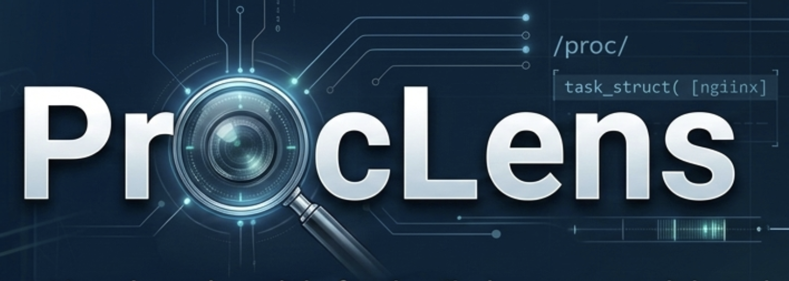
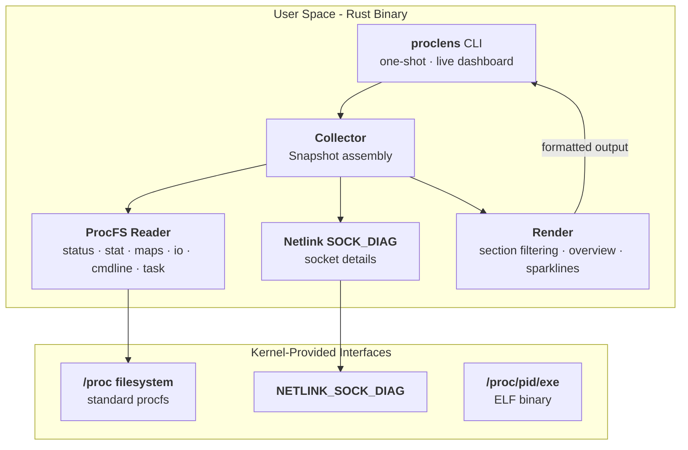

# ProcLens



[](https://github.com/navidpadid/ProcLens/actions/workflows/ci.yml)
[](https://github.com/navidpadid/ProcLens/commits/main)
[](LICENSE)

> A pure userspace Rust process inspector — memory layout, CPU usage, network/socket activity, per-process I/O accounting, and live section-based inspection. No kernel module required.


## Live Demo


## Table of Contents

- [Features](#features)
- [Quick Start](#quick-start)
- [Release Binaries](#release-binaries)
- [Makefile Targets](#makefile-targets)
- [Testing](#testing)
- [Architecture Diagram](#architecture-diagram)
- [Project Structure](#project-structure)
- [Output Notes](#output-notes)
- [Code Quality](#code-quality)
- [Documentation](#documentation)
- [Contributing](#contributing)
- [License](#license)

## Features

- **Process Memory Layout**: Code, Data, BSS, Heap, and Stack addresses
- **Memory Pressure Monitoring**: RSS, VSZ, swap usage, page faults (major/minor), and OOM score adjustment
- **Visual Memory Map**: Proportional bar chart visualization of memory regions
- **Open Sockets**: List all open sockets with family, type, state, protocol, addresses, and per-socket traffic stats
- **Network Stats (Brief)**: Per-process TCP counters, socket counts (TCP/UDP/UNIX), drops, net devices, and top talkers
- **I/O Stats**: Per-process I/O accounting (`rchar`, `wchar`, `syscr`, `syscw`, storage bytes) with averages and intensity
- **Thread Information**: List all threads with TID, state, CPU usage, priority, and CPU affinity
- **CPU Usage Tracking**: Real-time CPU percentage calculation per process and thread
- **ELF Section Analysis**: Binary base address and section boundaries
- **Pure Userspace**: No kernel module — reads directly from `/proc` and `NETLINK_SOCK_DIAG`
- **Live Dashboard Mode**: No-arg mode refreshes every 1s with a condensed Overview page, recent trend plots, and switchable Memory, Network, Threads, and I/O sections
- **Comprehensive Testing**: Unit tests with Devbox
- **Code Quality**: `cargo fmt` + `cargo clippy` with CI enforcement

## Quick Start

### Prerequisites

- **Rust** 1.75+ or **Devbox** (`devbox shell` sets up everything)
- Linux with `/proc` filesystem for live process inspection (any distro, no kernel headers needed)

### Development

#### macOS

On macOS there is no `/proc` filesystem, so you can build and run unit tests natively, but live process inspection requires Docker or a Linux VM.

```bash
# Install Devbox (if not already installed)
curl -fsSL https://get.jetpack.io/devbox | bash

# Enter dev environment (installs Rust toolchain automatically)
devbox shell

# Build
cargo build --release          # or: make all / devbox run build

# Unit tests (works on macOS — uses fake /proc fixtures)
cargo test                     # or: make unit / devbox run test

# Code quality
cargo fmt                      # or: make format / devbox run fmt
cargo clippy                   # or: make check  / devbox run lint
cargo fmt -- --check && cargo clippy && cargo test  # or: devbox run check
```

For E2E testing with real processes on macOS, use Docker:

```bash
./e2e.sh                                              # all E2E tests in Docker
docker build -f Dockerfile.e2e -t proclens-e2e .      # manual build
docker run --rm proclens-e2e ./build/proclens 1       # one-shot with PID 1
docker run --rm -it proclens-e2e ./build/proclens     # live dashboard (interactive)
```

With fake `/proc` (works on any platform, no Docker needed):

```bash
PROCLENS_PROC_DIR=/tmp/fake_proc ./target/release/proclens 123
```

#### Linux (Native)

On Linux, all features work natively including live process inspection:

```bash
# Option 1: Devbox (recommended — reproducible environment)
devbox shell
cargo build --release
./target/release/proclens $$        # one-shot with current shell
./target/release/proclens           # live dashboard

# Option 2: Direct Rust install
curl --proto '=https' --tlsv1.2 -sSf https://sh.rustup.rs | sh
cargo build --release
cargo test
sudo make install                   # install to /usr/local/bin

# Option 3: Make shims
make all                            # build
make unit                           # test
make run-multithread                # multi-threaded test
make format && make check           # fmt + clippy
```

#### WSL (Windows Subsystem for Linux)

WSL2 provides a full Linux kernel with `/proc`, so ProcLens works natively:

```bash
# Inside WSL2 Ubuntu/Debian
devbox shell                        # or install Rust directly
cargo build --release
./target/release/proclens $$        # works — WSL has /proc
./target/release/proclens           # live dashboard works

# Docker also works inside WSL if Docker Desktop is configured
./e2e.sh
```

> **Note:** No kernel module needed on any platform. The binary reads directly from `/proc` — works on any Linux distro/WSL without headers or `insmod`.

### Uninstall

```bash
sudo make uninstall
# or
sudo rm /usr/local/bin/proclens
```


## Release Binaries

Download prebuilt binaries from GitHub Releases:

- Latest release: https://github.com/navidpadid/ProcLens/releases/latest
- All releases: https://github.com/navidpadid/ProcLens/releases

> Prebuilt binaries are provided for `x86_64` and `aarch64` Linux. No kernel version restriction.


After downloading, the preferred installation/update path is to use the bundled installer scripts:

```bash
tar xzf proclens-vX.Y.Z-linux-x86_64.tar.gz
sudo install -m 755 proclens /usr/local/bin/proclens
proclens --version
```

Manual install/run is still possible if needed:

```bash
./proclens <PID>
./proclens  # live dashboard
```

See `proclens --help` for usage.


## Makefile Targets

```bash
Build Targets:
  make all               - Build Rust binary (default)
  make build             - Build Rust binary
  make build-multithread - Build multi-threaded test program (C)

Run Targets:
  make install           - Install binary to /usr/local/bin
  make uninstall         - Remove binary
  make test              - Build and run with current PID

Test Targets:
  make unit              - Run Rust unit tests (cargo test)
  make run-multithread   - Test with multi-thread program

Code Quality Targets:
  make check             - Run clippy
  make clippy            - Run clippy
  make format            - Format with cargo fmt
  make format-check      - Check formatting (cargo fmt --check)

Cleanup Targets:
  make clean             - Remove build artifacts
```

## Testing

### Unit Tests

Works on all platforms (macOS, Linux, WSL) — no `/proc` needed:

```bash
cargo test             # or: make unit / devbox run test
```

Tests pure helpers and procfs parsing with fake `/proc` fixtures via `PROCLENS_PROC_DIR`.

### Manual Testing (Linux / WSL)

```bash
./target/release/proclens $$        # one-shot with current shell
./target/release/proclens           # live dashboard
```

### Manual Testing (macOS — Fake Proc)

```bash
PROCLENS_PROC_DIR=/tmp/fake_proc ./target/release/proclens 123  # with fake proc
```

### Multi-threaded Test (Linux / Docker)

```bash
make run-multithread                # Linux/WSL native
./e2e.sh                            # Docker (works on macOS too)
```

### E2E Testing (Docker — All Platforms)

```bash
./e2e.sh                            # build + run all E2E tests in Docker
# or manually:
docker build -f Dockerfile.e2e -t proclens-e2e .
docker run --rm proclens-e2e ./build/proclens 1
docker run --rm proclens-e2e bash -c './build/test_multithread & sleep 1; ./build/proclens $!; wait'
```

For live dashboard testing, run interactively:

```bash
docker run --rm -it proclens-e2e ./build/proclens
```

## Architecture Diagram



## Project Structure

```
ProcLens/
├── .github/            # CI/CD workflows (GitHub Actions)
├── design/             # Design docs (Rust migration plan)
├── docs/               # Detailed documentation
├── src/                # Rust source (main, collector, procfs, render, live, util, config)
│   └── test_multithread.c  # C helper for multi-thread testing
├── Cargo.toml          # Rust manifest
├── devbox.json         # Devbox environment
├── build/              # Build artifacts
└── Makefile            # Build shim (cargo build/test/fmt/clippy)
```

## Output Notes

- **Memory Visualization**: Each region's bar length is proportional to its actual size
- Sizes are automatically displayed in appropriate units (B, KB, or MB)
- Low/High addresses show the memory address range of the process
- BSS_START and BSS_END may be equal (zero-length BSS) in modern ELF binaries. This is normal.
- **Open Sockets**: Shows file descriptor, socket family, type, state, protocol, addresses, and traffic stats for TCP/UDP sockets
- Socket families: AF_INET (IPv4), AF_INET6 (IPv6), AF_UNIX (Unix domain), AF_NETLINK (Netlink)
- UDP traffic values are queue-based (current queued packets/bytes), while TCP traffic values are lifetime socket counters.
- **Top Talkers**: The `[network]` section includes up to three sockets ranked by total bytes (`RX + TX`) at read time.
- **I/O Stats**: The `[io]` section includes syscall bytes/counters, storage bytes, derived average bytes per syscall, and `io_intensity` (`read_bytes + write_bytes`). All byte-count fields are displayed with human-readable units (B, KB, MB, GB).
- If the running kernel disables task I/O accounting (`CONFIG_TASK_XACCT`), the I/O section prints a clear `status: unavailable` line instead of counters.
- Thread STATE: R=Running, S=Sleeping, D=Uninterruptible, T=Stopped, t=Traced, Z=Zombie, X=Dead
- PRIORITY: Shown as nice value (-20 to 19, where lower is higher priority)
- CPU_AFFINITY: Shows which CPUs the thread can run on

## Code Quality

### Static Analysis Tools

#### cargo fmt
Code formatter — 100-column limit, Rust 2021 edition.

#### cargo clippy
Linter for common mistakes, style issues, and performance hints.

#### cargo test
Unit tests for all pure helpers and procfs parsing.

## Documentation

- [TESTING.md](docs/TESTING.md) - Unit tests and troubleshooting
- [TECHNICAL.md](docs/TECHNICAL.md) - Kernel module details, memory layout, limitations
- [CODE_QUALITY.md](docs/CODE_QUALITY.md) - Static analysis, code formatting, best practices
- [SCRIPTS.md](docs/SCRIPTS.md) - Devbox and automation scripts
- [RELEASE.md](docs/RELEASE.md) - Version release process and guidelines
- [AGENTIC_WORKFLOW.md](docs/AGENTIC_WORKFLOW.md) - High-level guide for the docs agent workflow

## Contributing

Contributions welcome! The project includes:
- Devbox for reproducible dev environments (`devbox shell`)
- Automated testing (`cargo test`)
- `cargo fmt` + `cargo clippy` with CI enforcement
- GitHub Actions CI/CD

## License

MIT License. See [LICENSE](LICENSE) for full terms.