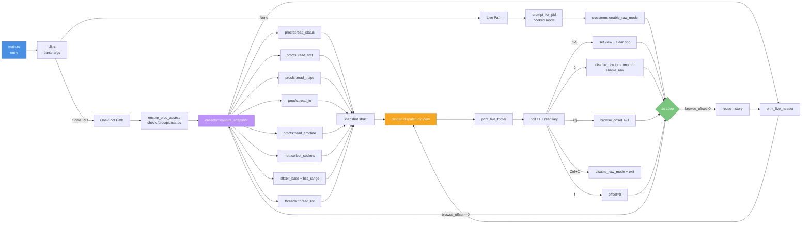
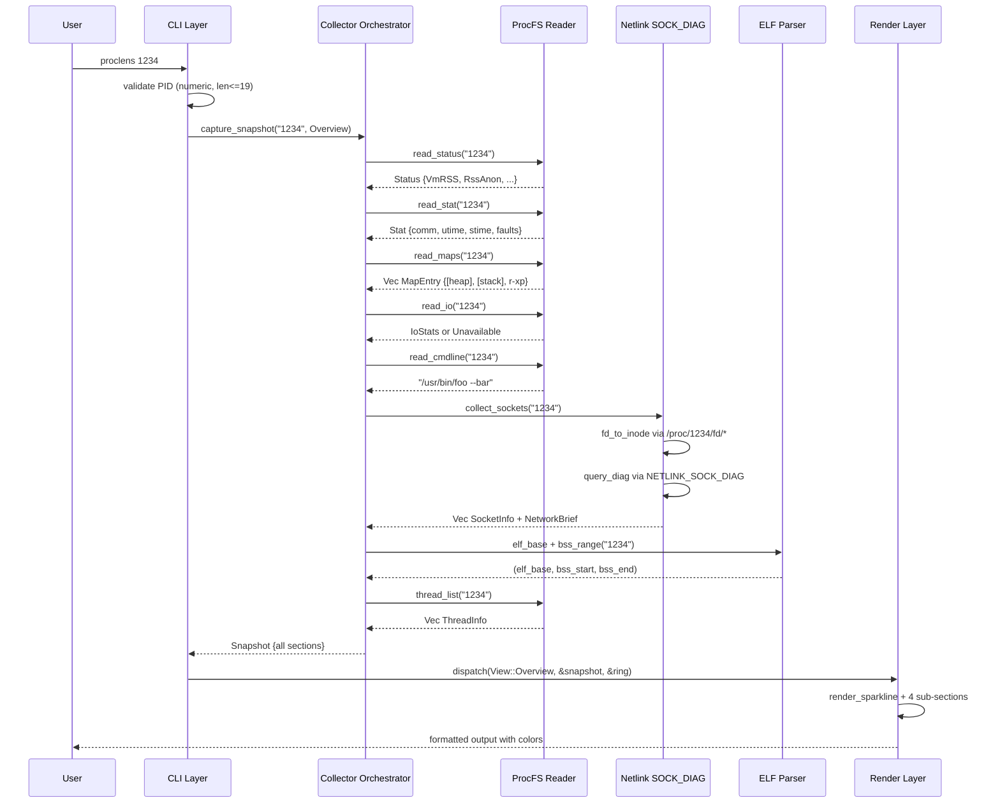
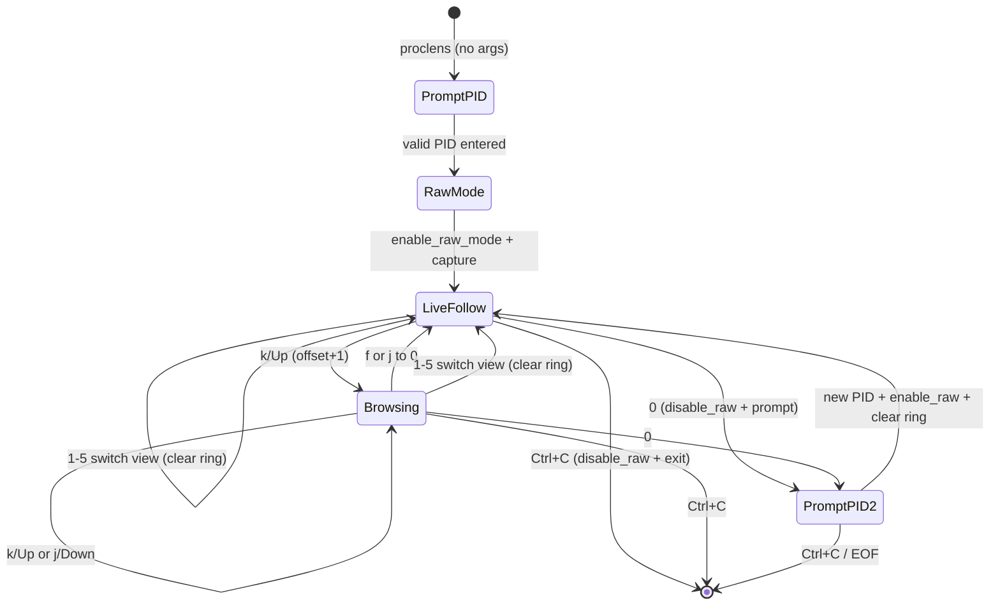
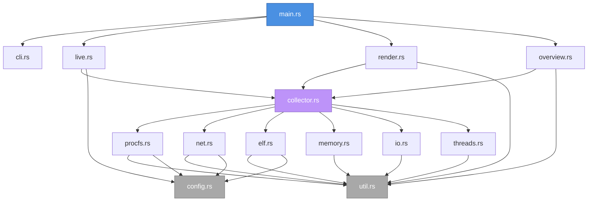
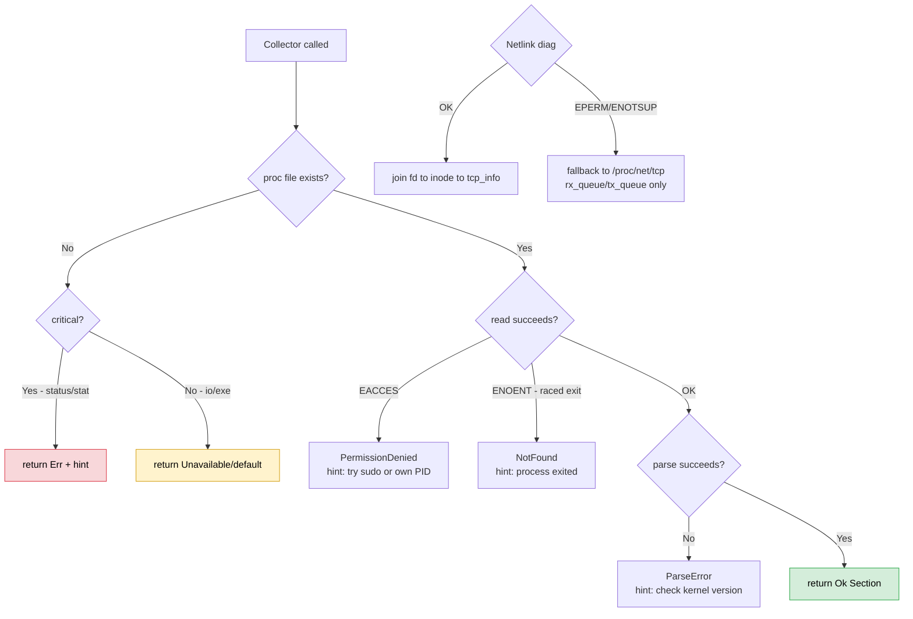
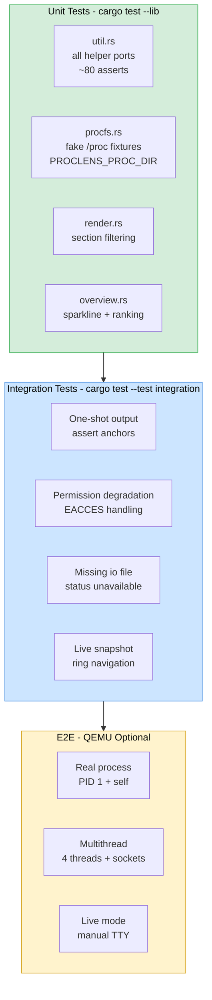
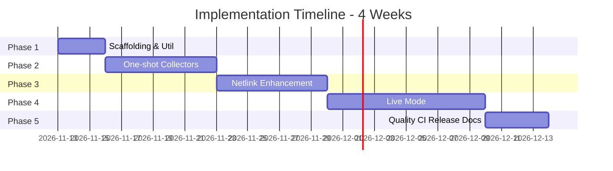

# ProcLens Pure Userspace Rust Migration (Option C)

## Authors

ProcLens Maintainers

## Introduction

ProcLens currently ships as a hybrid C project: a Linux kernel module (`proclens_module.ko`) that aggregates per-process data via `/proc/proclens_module/{pid,det,threads}` and a C CLI (`proclens`) that renders one-shot and live dashboard views. This design requires kernel headers, `sudo insmod`/`rmmod`, `checkpatch`/`sparse` gates, and QEMU-based E2E for safe kernel testing.

This design migrates ProcLens to a **pure userspace Rust program (Option C)**: remove the kernel module entirely and reimplement all data collection from standard Linux interfaces (`/proc/<pid>/*`, `NETLINK_SOCK_DIAG`, ELF parsing via `goblin`). The CLI retains full feature parity (memory pressure/layout, network brief + open sockets, I/O stats, threads, live overview with sparklines) while eliminating kernel build/install, root-for-load, and kernel-version coupling. Distribution becomes a single static binary via `cargo`/`cross`.

**Goals:**
- Zero kernel dependency at build and runtime.
- Single binary distribution (`proclens` only, no `.ko`).
- No `sudo` for own processes; graceful degradation for others.
- Preserve all current output anchors and live UX.
- Modern Rust toolchain: `cargo fmt`/`clippy`/`test`, `cargo-audit`, `cargo-deny`.

**Non-goals:**
- Kernel Rust (`Rust for Linux`) — out of scope.
- eBPF-based collection — future enhancement, not required for parity.
- Windows/macOS support — Linux-only, same as today.

## Requirements

1. **No kernel module:** No `proclens_module.ko`, no `/proc/proclens_module`, no `insmod`/`rmmod`, no `Kbuild`, no kernel headers at build time.
2. **Feature parity:** One-shot `proclens <PID>` and live `proclens` (no args) must produce the same sections and fields as today: basic (PID/comm/CPU%), memory pressure (RSS/VSZ/swap/faults/OOM), memory layout + visualization, network brief (sockets_total, rx/tx, retransmits, drops, net_devices, top_talkers), open sockets (FD/family/type/state/proto/traffic/addrs), I/O stats (rchar/wchar/syscr/syscw/read_bytes/write_bytes/cancelled/avg/intensity), threads (TID/name/CPU%/state/prio/nice/affinity), overview (trends + 4 snapshots + hotspots).
3. **Output compatibility:** Human-readable output strings must remain compatible with existing `e2e/qemu-test.sh` assertions (`Memory Pressure Statistics`, `[network]`, `sockets_total:`, `net_devices:`, `top_talkers:`, `[io]`, `avg_read_bytes_per_syscall:` or `status: unavailable`, `io_intensity:`, `Open Sockets`, `Proto:`, `Traffic: RX`) unless explicitly versioned.
4. **Live behavior preserved:** 1s refresh, default `Overview` (5), section keys `1-5`, `0` PID switch (cooked-mode prompt), `k/j` history browse, `f` follow, timestamps `YY/MM/DD HH:MM:SS`, 120-entry ring, 32-sample sparklines (`▁▂▃▄▅▆▇█`) for CPU/RSS/RX/s/TX/s/RD/s/WR/s.
5. **Permissions:** Reading own PID requires no root; reading other users' PIDs degrades gracefully on `EACCES` (no panic, clear message). No `ensure_root_privileges` hard gate for read-only paths.
6. **Build/test/quality:** `cargo build`/`cargo test`/`cargo fmt`/`cargo clippy` replace `make all`/`make unit`/`make format`/`make check`. CI runs on `ubuntu-24.04` without kernel headers. Release cross-builds `amd64`+`arm64` binaries via `cargo`/`cross`.
7. **Docs & release:** Update `README.md`, `docs/TECHNICAL.md`, `docs/TESTING.md`, `docs/CODE_QUALITY.md`, `docs/SCRIPTS.md`, `docs/RELEASE.md`, and arch diagram to reflect userspace-only flow. Release artifact renamed to `proclens-vX.Y.Z-linux-{arch}.tar.gz` (no `6.8.0` suffix).
8. **Performance:** One-shot <50ms for typical PID; live tick <20ms (excluding 1s sleep); memory <10MB RSS; no per-tick allocations in hot path beyond snapshot clone.

## Hypothesis Document

Not applicable — this is a reimplementation preserving existing product behavior with reduced operational burden. Success is measured by: (a) all current unit/E2E assertions pass against the Rust binary, (b) no kernel build dependency, (c) single-binary distribution, (d) `cargo test` + `cargo clippy -- -D warnings` green.

## High-level Design

### 1. System Context — Before vs After

```mermaid
flowchart LR
    subgraph Before[Before - Hybrid C + Kernel Module]
        U1[User] --> C1[proclens C CLI]
        C1 -->|write PID| P1[/proc/proclens_module/pid]
        C1 -->|read| D1[/proc/proclens_module/det]
        C1 -->|read| T1[/proc/proclens_module/threads]
        P1 --> M1[proclens_module.ko<br/>task_struct/mm_struct/tcp_sock]
        D1 --> M1
        T1 --> M1
        M1 --> K1[Kernel Data Sources<br/>RCU/mmap_lock/seq_file]
    end

    subgraph After[After - Pure Userspace Rust]
        U2[User] --> C2[proclens Rust CLI<br/>single binary]
        C2 -->|read| P2[/proc/pid/status stat maps io cmdline task/fd]
        C2 -->|netlink| N2[NETLINK_SOCK_DIAG<br/>tcp_info]
        C2 -->|read| E2[/proc/pid/exe<br/>ELF via goblin]
        P2 --> K2[Kernel procfs<br/>standard, no module]
        N2 --> K2
        E2 --> K2
    end

    style Before fill:#FFF3CD,stroke:#D4A017,color:#000
    style After fill:#D4EDDA,stroke:#28A745,color:#000
    style M1 fill:#F8D7DA,stroke:#DC3545,color:#000
    style C2 fill:#4A90E2,stroke:#2C5AA0,color:#fff
```

**Key shift:** The custom `/proc/proclens_module` indirection is removed. The Rust binary talks directly to stable kernel interfaces that exist on every Linux distro since 4.5+.

### 2. Architecture Overview — Rust Binary Internals

```mermaid
flowchart TB
    subgraph UserSpace[User Space - Rust Binary - Single Process]
        CLI[CLI Layer<br/>src/main.rs + cli.rs<br/>clap: proclens PID / live<br/>--help --version]
        Live[Live Engine<br/>src/live.rs<br/>raw mode + ring buffer<br/>1s tick + key handling]
        Render[Render Layer<br/>src/render.rs + overview.rs<br/>color + section filtering<br/>sparklines + tables]
        Collect[Collector Orchestrator<br/>src/collector.rs<br/>Snapshot assembly<br/>parallel where safe]
        ProcFS[ProcFS Reader<br/>src/procfs.rs<br/>status stat statm maps<br/>io cmdline task oom]
        NetDiag[Netlink SOCK_DIAG<br/>src/net.rs<br/>fd to inode + inet_diag<br/>tcp_info + udp queues]
        ELF[ELF Parser<br/>src/elf.rs<br/>goblin on /proc/pid/exe<br/>bss/heap/stack/base]
        Util[Util<br/>src/util.rs<br/>format_size bar_width<br/>state strings top_talkers]
        Config[Config<br/>src/config.rs<br/>proc_root + color<br/>PROCLENS_PROC_DIR]
    end

    subgraph KernelProvided[Kernel-Provided Interfaces - No Custom Module]
        ProcFiles[/proc Filesystem<br/>standard procfs<br/>no headers needed]
        NetlinkSock[Netlink Socket<br/>SOCK_DIAG<br/>AF_INET/AF_INET6]
        ExeLink[/proc/pid/exe<br/>ELF binary<br/>symlink to exe]
    end

    CLI --> Live
    CLI --> Collect
    Live --> Collect
    Collect --> ProcFS
    Collect --> NetDiag
    Collect --> ELF
    Collect --> Util
    Collect --> Config
    Render --> Collect
    Live --> Render
    ProcFS --> ProcFiles
    NetDiag --> NetlinkSock
    ELF --> ExeLink
    ProcFS -.->|fallback on EACCES| NetDiag
    Config -.->|proc_root| ProcFS
    Config -.->|color policy| Render

    style CLI fill:#4A90E2,stroke:#2C5AA0,color:#fff
    style Live fill:#7BC67E,stroke:#4A8C4E,color:#fff
    style Render fill:#F5A623,stroke:#C07D15,color:#fff
    style Collect fill:#BD93F9,stroke:#8B6FC0,color:#fff
    style ProcFS fill:#6EC1E4,stroke:#3A8FB7,color:#fff
    style NetDiag fill:#6EC1E4,stroke:#3A8FB7,color:#fff
    style ELF fill:#6EC1E4,stroke:#3A8FB7,color:#fff
    style Util fill:#A8A8A8,stroke:#777,color:#fff
    style ProcFiles fill:#FF6B6B,stroke:#CC5555,color:#fff
    style NetlinkSock fill:#FF6B6B,stroke:#CC5555,color:#fff
    style ExeLink fill:#FF6B6B,stroke:#CC5555,color:#fff
```

### 3. Component Interaction — Who Calls Whom



### 4. Data Flow — One-Shot Sequence



### 5. Live Mode State Machine



### 6. Crate & Module Dependency Graph



### Storyline

1. **Entry:** User runs `proclens` (live) or `proclens <PID>` (one-shot). `CLI Layer` parses args via `clap`, handles `--help`/`--version`, and validates PID bounds (19 chars, numeric). No hard root gate; permission errors are deferred to collectors.
2. **One-shot path:** `CLI` calls `Collectors` for the given PID. Each collector reads its source: `ProcFS Reader` opens `/proc/<pid>/status|stat|maps|io|cmdline` and `/proc/<pid>/task/*`; `Netlink SOCK_DIAG` queries `AF_INET`/`AF_INET6` sockets for `tcp_info` (bytes/packets/retrans); `ELF Parser` optionally reads `/proc/<pid>/exe` for BSS bounds. Results are assembled into a `Snapshot` struct.
3. **Live path:** `Live Engine` prompts for PID, enables raw terminal mode (`crossterm`), then loops every 1s: capture `Snapshot` → push to 120-entry `VecDeque` ring → select current view (`Memory`/`Network`/`Threads`/`I/O`/`Overview`) → `Render Layer` prints header (PID, section, index, timestamps), section body, and footer. Input polling via `event::poll(1s)` handles `1-5` (switch view + clear history), `0` (disable raw → cooked prompt → re-enable), `k/j` (browse offset), `f` (follow).
4. **Render:** `Render Layer` filters the `Snapshot` by view (preamble, memory-only, network-only, I/O-only, or full overview with sparklines). Overview computes 32-sample trends from ring history (CPU/RSS/RX/s/TX/s/RD/s/WR/s) and renders 4 sub-sections (Memory/Network/I/O/Thread Hotspots) with color codes. Output strings preserve current assertion anchors.
5. **Degradation:** If `/proc/<pid>/io` is absent (`CONFIG_TASK_IO_ACCOUNTING=n`), emit `status: unavailable`. If netlink fails or `EACCES` on `fd` dir, fall back to procfs `rx_queue`/`tx_queue` and mark `drops: unavailable` or `0`. All collectors return `Result` with context; top-level prints `hint:` on failure.

## Low-level Design

### Shared Operational State

```rust
// Snapshot is the single source of truth for one refresh tick
struct Snapshot {
    pid: String,              // bounded 19 chars, validated numeric
    view: View,               // Memory=1, Network=2, Threads=3, Io=4, Overview=5
    captured_at: String,      // YY/MM/DD HH:MM:SS via chrono/localtime_r
    basic: BasicInfo,         // pid, comm, cpu_permyriad, cmdline
    memory_pressure: MemoryPressure, // rss_kb, anon/file/shmem, vsz, swap, faults, oom_adj
    memory_layout: MemoryLayout,     // code/data/bss/heap/stack/elf_base + visualization
    network_brief: NetworkBrief,     // sockets_total, rx/tx packets/bytes, retrans, drops, net_devices, top_talkers[3]
    sockets: Vec<SocketInfo>,        // per-FD: fd, family, type, state, proto, traffic, local/remote
    io_stats: IoStats,               // rchar/wchar/syscr/syscw/read/write/cancelled/avg/intensity or Unavailable
    threads: Vec<ThreadInfo>,        // tid, name, cpu%, state, prio, nice, affinity
}

enum View { Memory=1, Network=2, Threads=3, Io=4, Overview=5 }

struct RingBuffer {
    buf: VecDeque<Snapshot>, // cap 120, VecDeque for O(1) push/pop
    browse_offset: usize,    // 0 = live follow, >0 = history browsing
}

struct BasicInfo {
    pid: u32,
    comm: String,             // from /proc/pid/stat (handles spaces via rfind(')'))
    cpu_permyriad: u64,       // percent*100, via compute_usage_permyriad
    cmdline: String,          // NUL→space from /proc/pid/cmdline
}

struct MemoryPressure {
    rss_kb: u64, anon_kb: u64, file_kb: u64, shmem_kb: u64,
    vsz_kb: u64, swap_kb: u64,
    major_faults: u64, minor_faults: u64,
    oom_score_adj: i32,
}

struct MemoryLayout {
    code_start: u64, code_end: u64,
    data_start: u64, data_end: u64,
    bss_start: u64, bss_end: u64,
    heap_start: u64, heap_end: u64,
    stack_start: u64, stack_end: u64,
    elf_base: u64,
}

struct NetworkBrief {
    sockets_total: usize, tcp_count: usize, udp_count: usize, unix_count: usize,
    rx_packets: u64, tx_packets: u64, rx_bytes: u64, tx_bytes: u64,
    tcp_retransmits: u64, drops: u64,
    net_devices: Vec<(String, usize)>, // (name, count) e.g. eth0=2
    top_talkers: Vec<TopTalker>,       // sorted by rx+tx desc, max 3
}

struct SocketInfo {
    fd: u32, family: String, sock_type: String, state: String, proto: String,
    rx_packets: u64, rx_bytes: u64, tx_packets: u64, tx_bytes: u64,
    local: String, remote: String, // "127.0.0.1:8080" or "[::1]:8080"
}

struct IoStats {
    rchar: u64, wchar: u64, syscr: u64, syscw: u64,
    read_bytes: u64, write_bytes: u64, cancelled_write_bytes: u64,
    avg_read_per_syscall: u64, avg_write_per_syscall: u64,
    io_intensity: u64, // read+write
    available: bool,   // false → render "status: unavailable"
}

struct ThreadInfo {
    tid: u32, name: String, cpu_permyriad: u64,
    state: char, // R/S/D/T/t/Z/X/?
    priority: i32, nice: i32, affinity: String, // "0,1,2,3" or "none"
}
```

All collectors are pure functions `fn(pid: &str) -> Result<Section, CollectError>` with no global state. `PROCLENS_PROC_DIR` env override is supported for testing (prefix for `/proc` root). `clk_tck` and `page_size` are cached via `OnceLock`.

### Error Handling & Fallback Strategy



**Error type:**
```rust
#[derive(thiserror::Error, Debug)]
enum CollectError {
    #[error("no such process: {pid}")] NotFound { pid: String },
    #[error("permission denied for PID {pid}")] PermissionDenied { pid: String },
    #[error("failed to parse {field}: {source}")] ParseError { field: String, source: String },
    #[error("netlink unavailable, using fallback")] NetlinkFallback,
}
```

### Component: CLI Layer (`src/main.rs`, `src/cli.rs`)

- **API:** `fn main()` → `clap::Parser` with `Args { pid: Option<String>, help, version }`. PID validated: numeric, `len <= 19`, else truncate with warning. `--version` from `CARGO_PKG_VERSION` (set via `PROCLENS_VERSION` env or `Cargo.toml` version).
- **Behavior:** One-shot if `pid.is_some()`, else live. No `ensure_module_loaded`/`ensure_proc_files_present`; instead `ensure_proc_access(pid)` checks `/proc/<pid>/status` exists, else `eprintln!("error: no such process: {pid}")` + `hint: check PID or try sudo for other users' processes`.
- **State:** None beyond args. `Args` is `#[derive(Parser)]` with `#[arg(value_name="PID")]`.

### Component: ProcFS Reader (`src/procfs.rs`)

- **API:**
  ```rust
  fn read_status(pid: &str) -> Result<Status>      // VmRSS, VmSize, VmSwap, RssAnon/File/Shmem
  fn read_stat(pid: &str) -> Result<Stat>          // comm, utime, stime, starttime, minflt, majflt, num_threads, state
  fn read_statm(pid: &str) -> Result<Statm>        // fallback for RSS/VSZ in pages
  fn read_io(pid: &str) -> Result<IoStats>         // rchar..cancelled, None if file missing
  fn read_cmdline(pid: &str) -> Result<String>     // NUL→space, trim
  fn read_maps(pid: &str) -> Result<Vec<MapEntry>> // addr ranges, perms, pathname
  fn read_task_pids(pid: &str) -> Result<Vec<String>> // list /proc/<pid>/task/*
  fn read_thread_stat(pid: &str, tid: &str) -> Result<ThreadStat>
  fn read_oom_score_adj(pid: &str) -> Result<i32>
  fn clk_tck() -> i64                              // sysconf(_SC_CLK_TCK), cached
  fn page_size() -> u64                            // sysconf(_SC_PAGESIZE), cached
  ```
- **Details:** All paths via `proc_root()` (`PROCLENS_PROC_DIR` or `/proc`). `read_status` parses `status` line-by-line; `RssAnon` etc. may be absent on old kernels → fallback to `smaps_rollup` or `0`. `read_stat` handles comm with spaces via `rfind(')')` — field 2 is `(comm)` which may contain spaces/parens. CPU% computed as `(utime+stime)*10000 / (now - starttime)` where `now` from `/proc/stat` btime + `uptime`, or two-sample delta for live (store prev `utime+stime` + timestamp in `RingBuffer`). `read_maps` parses `address perms offset dev inode pathname` per line.
- **Errors:** `CollectError::NotFound`, `PermissionDenied`, `ParseError` with `hint:`.

### Component: Netlink SOCK_DIAG (`src/net.rs`)

- **API:**
  ```rust
  fn collect_sockets(pid: &str) -> Result<Vec<SocketInfo>>
  fn collect_network_brief(pid: &str, sockets: &[SocketInfo]) -> NetworkBrief
  fn fd_to_inode(pid: &str) -> Result<HashMap<u64, u32>> // fd -> inode via readlink /proc/<pid>/fd/*
  fn query_diag(inodes: &[u64]) -> Result<HashMap<u64, TcpInfo>> // netlink dump
  ```
- **Details:** `fd_to_inode` iterates `/proc/<pid>/fd`, `readlink` → `socket:[12345]` → parse inode. `query_diag` opens `NETLINK_SOCK_DIAG`, sends `SOCK_DIAG_BY_FAMILY` for `AF_INET`/`AF_INET6` with `IDIAG_INFO|IDIAG_EXT`, parses `inet_diag_msg` + `INET_DIAG_INFO` (`tcp_info` struct) for `tcpi_segs_in/out`, `tcpi_bytes_received`, `tcpi_bytes_acked`, `tcpi_retrans`, `idiag_if`, `idiag_state`. UDP: `idiag_rqueue/wqueue` as queued bytes. Map inode→info, join with fd. `family`/`type`/`state`/`proto` from `inet_diag_msg` + `socket` type via `getsockopt(SO_TYPE)` on fd if accessible, else infer from diag. Addresses from `idiag_src/dst` + `id.idiag_sport/dport` (network order, `ntohs`). `net_devices` via `if_indextoname(idiag_if)`. `top_talkers` = sort by `rx+tx` desc, take 3. `drops` from `sk_drops` not available via diag — report `0` or parse `/proc/net/netstat` if accessible.
- **Fallback:** If netlink fails (`EPERM`, `ENOTSUP`, container without `NETLINK_SOCK_DIAG`), degrade to parsing `/proc/<pid>/net/tcp*` for `rx_queue:tx_queue` and skip lifetime counters. Log `warn: netlink unavailable, showing queued bytes only`.

### Component: ELF Parser (`src/elf.rs`)

- **API:**
  ```rust
  fn elf_base(pid: &str, maps: &[MapEntry]) -> Result<u64> // first r-xp or r--p
  fn bss_range(pid: &str) -> Result<(u64,u64)>              // via goblin on /proc/<pid>/exe
  fn heap_range(maps: &[MapEntry]) -> (u64,u64)             // [heap] entry or brk approximation
  fn stack_range(maps: &[MapEntry]) -> (u64,u64)            // [stack] entry
  ```
- **Details:** `elf_base` = lowest `vm_start` among executable mappings (first `r-xp`). `bss_range` reads `/proc/<pid>/exe` (may fail `EACCES` → return `0,0` and note `BSS: unavailable (permission denied)`), parses ELF sections via `goblin`, finds `.bss` `sh_addr`/`sh_size` → `bss_start = sh_addr`, `bss_end = sh_addr + sh_size`. `heap_range` from `[heap]` maps line `addr_start-addr_end`; if absent, `0,0`. `stack_range` from `[stack]`. Visualization reuses `util::calculate_bar_width`/`generate_region_visualization` (50-char bar, proportional).

### Component: Memory / I/O / Threads (`src/memory.rs`, `src/io.rs`, `src/threads.rs`)

- **API:**
  ```rust
  fn memory_pressure(pid: &str) -> Result<MemoryPressure>
  fn memory_layout(pid: &str) -> Result<MemoryLayout>
  fn io_stats(pid: &str) -> IoStats // always succeeds, Unavailable variant if no file
  fn thread_list(pid: &str) -> Result<Vec<ThreadInfo>>
  ```
- **Details:** `memory_pressure` joins `read_status` + `read_stat` + `read_oom_score_adj`. Computes `rss_kb` from `VmRSS` or `RssAnon+RssFile+RssShmem`. `io_stats` reads `/proc/<pid>/io`, formats via `util::format_size_with_unit`, computes `avg = rchar/max(syscr,1)`, `intensity = read+write`. If file missing, `available=false`. `thread_list` iterates `read_task_pids`, for each `read_thread_stat` + `sched_getaffinity` (via `nix::sched::sched_getaffinity`), `task_state_to_char` mapping (`R/S/D/T/t/Z/X`), CPU% per thread via `compute_usage_permyriad`.

### Component: Util (`src/util.rs`)

- **API:** Ports of `proclens_module.h` helpers: `compute_usage_permyriad`, `compute_bss_range`, `compute_heap_range`, `is_address_in_range`, `get_thread_state_char`, `build_cpu_affinity_string`, `format_size_with_unit`, `calculate_bar_width`, `generate_region_visualization`, `try_insert_top_talker`, `add_netdev_count`, `calculate_rss_pages`, `pages_to_kb`, `calculate_total_faults`, `is_valid_oom_score_adj`, `calculate_memory_usage_percent`, `format_page_fault_stats`, `is_high_memory_pressure`, `calculate_avg_bytes_per_syscall`, `calculate_io_intensity`, `socket_family_to_string`, `socket_type_to_string`, `socket_protocol_to_string`, `socket_state_to_string`, `format_tcp_traffic_line`, `format_udp_traffic_line`.
- **Details:** Pure, no I/O, fully unit-tested. `format_size_with_unit` thresholds: `>=1GB` (1024^3), `>=1MB` (1024^2), `>=1KB` (1024), else `B`. `calculate_bar_width` ensures min 1 for non-zero. All functions `pub` for test access.

### Component: Live Engine (`src/live.rs`)

- **API:**
  ```rust
  fn run_live() -> Result<()>
  fn capture_snapshot(pid: &str, view: View) -> Result<Snapshot>
  fn ring_append(ring: &mut RingBuffer, snap: Snapshot)
  fn ring_get(ring: &RingBuffer, offset: usize) -> Option<&Snapshot>
  ```
- **Details:** `run_live` prompts PID (cooked `read_line`), `enable_raw_mode` (`crossterm::terminal`), loop: if `browse_offset==0` capture+append, else reuse history; `print_live_header` (clear screen `ESC[H ESC[2J`, PID, view name, index `history_count - offset / history_count`, timestamps), `print_live_snapshot` (dispatch by view), `print_live_footer`; `poll(1s)` + `read()` for keys. `0` → `disable_raw_mode` → `prompt_for_pid` → `enable_raw_mode` + clear ring. `1-5` → set view + clear ring. `k/Up` → `offset+1 < len`, `j/Down` → `offset>0`, `f` → `0`. `Ctrl+C` via `crossterm` event or SIGINT handler (`signal-hook`) restores terminal via `Drop` guard.

### Component: Render Layer (`src/render.rs`, `src/overview.rs`)

- **API:**
  ```rust
  fn print_det_preamble(snap: &Snapshot)
  fn print_memory_view(snap: &Snapshot)
  fn print_network_view(snap: &Snapshot)
  fn print_io_view(snap: &Snapshot)
  fn print_threads_view(snap: &Snapshot)
  fn print_overview(snap: &Snapshot, ring: &RingBuffer)
  fn render_sparkline(values: &[u64]) -> String // 32 cols, ▁▂▃▄▅▆▇█
  fn collect_overview_series(ring: &RingBuffer, offset: usize) -> OverviewSeries
  ```
- **Details:** Each `print_*_view` filters `Snapshot` fields and emits color-coded lines matching current `proclens.c` prefixes (`Memory Pressure Statistics:`, `Memory Layout:`, `[network]`, `sockets_total:`, `Open Sockets:`, `[io]`, `rchar:`, etc.). `print_overview` renders trends (CPU/RSS/RX/s/TX/s/RD/s/WR/s) via `render_sparkline` (8-level block, 32 samples, blank line between lanes) + current values, then 4 sub-sections: `MEMORY SNAPSHOT` (RSS/VSZ/Swap/Faults), `NETWORK SNAPSHOT` (sockets_total, rx/tx, retrans, drops, top_talkers table 2 rows), `I/O SNAPSHOT` (read/write/syscr/syscw/intensity or `status:`), `THREAD HOTSPOTS` (total + top 3 by CPU%). Colors via `crossterm::style` or `owo-colors`, gated by `isatty` + `NO_COLOR` env.

## Test Plan



- **Unit tests (`cargo test --lib`):** Port all `src/proclens_module_tests.c` asserts into `src/util.rs` `#[cfg(test)]` (CPU permyriad, BSS/heap, range, state, affinity, size/bar/viz, RSS/pages/faults/OOM/pressure, I/O avg/intensity, socket family/type/proto/state/traffic, top_talkers, netdev, pid buffer). Add `procfs.rs` tests with fake `/tmp/fake_proc` fixtures (status/stat/io/maps/cmdline) via `PROCLENS_PROC_DIR` override, mirroring `src/proclens_tests.c` mocks (happy path, bounded PID, missing proc file, permission denied, section filtering). Add `render.rs` tests for section filtering (memory view excludes `[network]`/`[io]`, etc.) and `overview.rs` tests for sparkline (all zeros → `▁`, all max → `█`, mixed → gradient) and top_talker/thread ranking (sort stability, max 3/2).
- **Integration tests (`tests/integration.rs`):** Spawn `test_multithread` helper (keep C binary or Rust port with `TcpListener`/`UdpSocket` + 4 threads), run `proclens <pid>` as subprocess with `PROCLENS_PROC_DIR` or real `/proc`, assert output contains `Memory Pressure Statistics`, `sockets_total:`, `net_devices:`, `top_talkers:`, `[io]`, `Open Sockets`, and for TCP/UDP `Traffic: RX`. Test permission degradation (non-root reading PID 1 → `permission denied` not panic) and missing `io` file (`status: unavailable`). Test live snapshot capture + ring navigation (append 3, browse offset 0→1→0).
- **E2E (QEMU optional):** Simplified `e2e/qemu-test.sh` without `insmod`/`rmmod`/`dmesg`: sync Rust binary into VM, run one-shot and live snapshot capture, assert same anchors as above. Keep QEMU for kernel-version matrix if desired, but not required for correctness. Manual TTY test for live controls (`1-5`, `0`, `k/j/f`, `Ctrl+C`).

**Coverage target:** >80% on `util`/`procfs`/`render`/`overview` (measured via `cargo tarpaulin` or `cargo llvm-cov`).

## Implementation Phases



**Phase 1 — Scaffolding & Util (3 days):**
- Deliverables: `cargo init`, `Cargo.toml` workspace, `rustfmt.toml` (100 cols), `clippy.toml`/`deny.toml`, `src/util.rs` with all helper ports + unit tests passing, `src/config.rs` with `proc_root()` + color policy, `src/procfs.rs` with `read_status/stat/io/cmdline/maps` + fake-proc tests, `PROCLENS_PROC_DIR` plumbing.
- Exit criteria: `cargo test --lib` green, `cargo fmt --check` green, `cargo clippy -- -D warnings` green.

**Phase 2 — One-shot Collectors (1 week):**
- Deliverables: `src/memory.rs`, `src/io.rs`, `src/threads.rs`, `src/net.rs` (procfs-only), `src/elf.rs`, `src/render.rs` section filters, `src/collector.rs` assembly, `src/cli.rs` + `src/main.rs` one-shot path. Output parity for `proclens <PID>` against current E2E anchors.
- Exit criteria: `cargo test` green, manual `proclens $$` and `proclens 1` show all sections, integration test `I1` passes.

**Phase 3 — Netlink Enhancement (1 week):**
- Deliverables: `src/net.rs` netlink diag path (`fd_to_inode` + `query_diag` + join + fallback), `net_devices` via `if_indextoname`, `top_talkers` ranking, `drops` handling. Validate `rx_bytes`/`tx_bytes`/`retrans`/`top_talkers` against real TCP connections (e.g., `curl` + `proclens`).
- Exit criteria: TCP lifetime counters match `ss -ti` or `nstat`, integration tests `I1`+`I2` pass, fallback tested by blocking netlink.

**Phase 4 — Live Mode (1.5 weeks):**
- Deliverables: `src/live.rs` raw mode + ring buffer + key handling + signal guard, `src/overview.rs` trends/sparklines/sub-sections (32 samples, 6 lanes, 4 sub-sections). Port `proclens.c` live controls (`1-5`, `0`, `k/j/f`, `Ctrl+C`).
- Exit criteria: Manual TTY testing passes (all keys, history browse, PID switch, color/no-color), integration test `I4` passes, no terminal corruption on exit (Drop guard).

**Phase 5 — Quality, CI, Release, Docs (4 days):**
- Deliverables: `Makefile` shim (`all`→`cargo build --release`, `unit`→`cargo test`, `format`→`cargo fmt`, `check`→`cargo clippy`), `ci.yml` (remove kernel headers/sparse/checkpatch, add `rustup`+`cargo test/clippy/fmt/audit`), `release.yml` (cargo cross `amd64`/`arm64`, binary-only bundle `proclens-vX.Y.Z-linux-{arch}.tar.gz` + `.sha256`), all docs (`README.md` arch diagram, `TECHNICAL.md` data sources table, `TESTING.md` cargo commands, `CODE_QUALITY.md` clippy/fmt, `SCRIPTS.md` simplified QEMU, `RELEASE.md` binary naming), `cargo deny`/`cargo audit` clean.
- Exit criteria: `cargo test` + `cargo clippy -- -D warnings` + `cargo fmt --check` + `cargo audit` green, coverage >80% on `util`/`procfs`/`render`, docs reviewed, release dry-run succeeds.

**Risks & Mitigations:**
- *Netlink unavailable in containers:* Fallback to procfs `rx_queue`/`tx_queue`, document as `queued` vs `lifetime`.
- *BSS/Heap approximation:* Document limitation (same as current `Heap Limitation` note), validate against `maps` + `goblin`.
- *Terminal raw mode corruption:* Use `Drop` guard + `signal-hook` for SIGINT/SIGTERM, test with `kill -INT`.
- *Performance regression:* Bench `capture_snapshot` with `criterion`, target <20ms p99.

### Crate Layout & Dependencies

```
ProcLens/ (Rust workspace)
├── Cargo.toml              # workspace, version, edition 2021, MSRV 1.75
├── Cargo.lock
├── rustfmt.toml            # max_width 100, edition 2021
├── clippy.toml             # deny warnings
├── deny.toml               # cargo-deny bans/licenses
├── src/
│   ├── main.rs             # entry, signal handling, terminal guard
│   ├── cli.rs              # clap Args, PID validation
│   ├── config.rs           # proc_root(), color policy, constants
│   ├── collector.rs        # Snapshot assembly, parallel collect
│   ├── procfs.rs           # /proc readers
│   ├── net.rs              # netlink + fallback
│   ├── elf.rs              # goblin ELF
│   ├── memory.rs           # pressure + layout
│   ├── io.rs               # io stats
│   ├── threads.rs          # thread list
│   ├── live.rs             # raw mode + ring + loop
│   ├── render.rs           # section filtering + color
│   ├── overview.rs         # trends + sub-sections
│   └── util.rs             # pure helpers (ported from proclens_module.h)
├── tests/
│   ├── integration.rs      # subprocess + fake proc
│   └── common/mod.rs       # test helpers
├── benches/
│   └── snapshot.rs         # criterion bench for capture_snapshot
└── e2e/
    └── test_multithread.rs # Rust port or keep C helper
```

**Dependencies:**
```toml
[dependencies]
clap = { version = "4", features = ["derive"] }
anyhow = "1"
thiserror = "2"
nix = { version = "0.27", features = ["sched", "signal"] }
libc = "0.2"
goblin = "0.8"
crossterm = "0.27"
chrono = "0.4"
owo-colors = "4"
netlink-packet-sock-diag = "0.4"
netlink-sys = "0.8"
signal-hook = "0.3"

[dev-dependencies]
tempfile = "3"
assert_cmd = "2"
predicates = "3"
criterion = "0.5"
```

